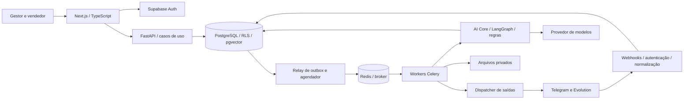

# Introdução

Esta especificação traduz o PRD do LeadFlow.IA em componentes, contratos, invariantes de dados e critérios verificáveis. A solução proposta é um monólito modular Python com API e workers independentes, interface Next.js, PostgreSQL como fonte de verdade e adaptadores de canal. A IA interpreta e propõe; regras de domínio autorizam; componentes específicos persistem e enviam.

O desenho prioriza a jornada completa no Telegram e sua reprodução no WhatsApp não oficial. Evita microserviços prematuros, mantém os processos demorados fora das requisições web e trata falhas, concorrência e resultados desconhecidos como estados explícitos.

## 1. Propósito e escopo

### 1.1 Autoridade e estado atual

- **Fonte funcional:** [PRD-v1.md](PRD-v1.md), regras RN-01 a RN-15, histórias US-01 a US-38 e cenários C01 a C46.
- **Referência técnica:** [plano de desenvolvimento](../docs/plano-desenvolvimento-codex.md). Sua stack serve de base; detalhes antigos de integração não substituem verificação de capacidade do provedor.
- **Estado observado:** branch `main`, sem histórico de commits e sem aplicação, migrations ou suíte de testes encontrados. Arquivos locais preexistentes permanecem preservados.
- **Autorização desta tarefa:** produzir esta SPEC. O pedido permite avançar na especificação; não significa aprovação automática das decisões V01–V10 nem autorização para implementar, provisionar serviços ou publicar.
- **Maturidade:** todas as escolhas técnicas novas são propostas desta versão. Após aprovação, “DEVE” é obrigatório, “NÃO DEVE” é proibição e “RECOMENDA-SE” admite alternativa fundamentada.
- O caminho de entrega `doc-specs/spec-v1.md` segue o pedido atual. O caminho antigo citado no final do PRD não será usado como destino.

### 1.2 Entregas cobertas

| Marco | Cobertura técnica | Limite |
| --- | --- | --- |
| M1 | Onboarding, identidade, conhecimento, produtos, vendedores, Telegram, atendimento, qualificação, CRM, acompanhamento e intervenção humana | Não concluir apenas com uma conversa de demonstração |
| M2 | WhatsApp não oficial, conexão por QR code, reconexão e equivalência comercial | Obrigatório para concluir o ciclo multicanal |
| M3 | Ponto de extensão para voz | Implementação somente após V10; não exige componente ativo agora |

Não inclui cobrança, CRM externo, campanhas, agenda externa, pagamentos, contratos, unificação automática entre canais, WhatsApp oficial, múltiplos agentes por empresa ou infraestrutura de alta disponibilidade.

### 1.3 Pendências do PRD e comportamento seguro

| Pendência | Consequência técnica | Condição para liberar |
| --- | --- | --- |
| V01 — Telegram self-service | `ChannelProvisioner` independente do atendimento; credencial manual somente em desenvolvimento | Prova da experiência aprovada e da associação segura do bot à empresa |
| V02 — Prontidão e segmento | Checklist versionado; dados sintéticos de demonstração | Campos obrigatórios e responsável de contingência aprovados |
| V03 — Qualificação | Categorias e evidências; não inventar pesos ou score numérico | Rubrica comercial versionada e massa de referência |
| V04 — Follow-up e opt-out | Política desabilitada até configuração válida; opt-out permanece bloqueado | Intervalos, limite, validade, horários, fuso e reautorização aprovados |
| V05 — Operação humana | Gestor pode assumir e atribuir; vendedor cadastrado não recebe acesso implícito | Habilitação, seleção de vendedor, permissões e prazo da fila aprovados |
| V06 — Arquivos e mídia | Texto obrigatório; mídia não interpretada recebe tratamento explícito | Formatos e limites de ingestão aprovados |
| V07 — Dados pessoais | Ambiente sintético até política de dados definida | Retenção, exclusão, aviso e responsabilidades estabelecidos |
| V08 — Volume, custo e metas | Limites técnicos configuráveis; métricas instrumentadas | Perfil de carga, orçamento e metas de piloto aprovados |
| V09 — Conflito de conhecimento | Abstenção e encaminhamento; sem desempate silencioso | Fontes autoritativas e resolução de conflitos aprovadas |
| V10 — Voz | Nenhuma dependência de voz no caminho obrigatório | Avaliação específica e critérios de aceite próprios |

Essas pendências impedem o aceite das capacidades correspondentes, não a documentação nem testes isolados com políticas sintéticas explícitas.

## 2. Definições

| Termo | Definição |
| --- | --- |
| SDR | Atendimento comercial inicial que coleta contexto, qualifica e encaminha oportunidades |
| Tenant / organização | Empresa proprietária de uma operação e seus dados |
| AI Core | Orquestrador independente de Telegram, WhatsApp e transporte de mensagens |
| LLM | Modelo de linguagem usado para interpretação e geração controlada |
| RAG | Recuperação de conteúdo da empresa para fundamentar a resposta |
| Grounding | Associação verificável de uma afirmação às fontes comerciais utilizadas |
| DTO | Representação de dados permitida em uma fronteira, distinta do registro interno completo |
| RLS | Política PostgreSQL que restringe linhas por contexto de acesso |
| RBAC | Autorização por papel, complementada por organização e atribuição da conversa |
| Inbox / outbox | Registros duráveis de eventos recebidos / ações pendentes de execução |
| Idempotência | Repetir uma solicitação identificada sem repetir seu efeito de negócio |
| Lease / fencing token | Posse temporária de uma execução / versão que rejeita gravações de um executor antigo |
| CAS | Atualização condicional pela versão esperada; detecta concorrência |
| Handoff | Encaminhamento à equipe, separado da efetiva assunção humana |
| Opt-out | Bloqueio de saídas automáticas solicitado pelo contato |
| SLA / SLO | Compromisso de serviço / objetivo operacional; ainda não aprovados para o piloto |
| DLQ | Fila lógica de operações esgotadas, com tratamento humano; nesta solução representada no banco |

Identidade do contato é local à organização e ao canal. Estágio comercial, modo de atendimento, preferência de contato e estado de envio são dimensões independentes.

## 3. Requisitos, restrições e diretrizes

### 3.1 Requisitos funcionais técnicos

| ID | Obrigação | Origem |
| --- | --- | --- |
| REQ-001 | Autenticar, autorizar por organização e restringir vendedores às conversas atribuídas | RN-01, RN-15 |
| REQ-002 | Versionar configuração e avaliar prontidão antes da ativação | RN-02 |
| REQ-003 | Provisionar/conectar canais com estado, idempotência e recuperação | RN-03 |
| REQ-004 | Ingerir e consultar conhecimento isolado, com versões e evidências | RN-04 |
| REQ-005 | Registrar mensagens, identidade local, correções e conteúdo não suportado | RN-05 |
| REQ-006 | Qualificar por rubrica explícita e preservar revisão humana | RN-06 |
| REQ-007 | Manter CRM, histórico, atribuição, resumo e trilha de alterações | RN-07 |
| REQ-008 | Encaminhar sem exigir resumo ou vendedor disponível | RN-08 |
| REQ-009 | Aplicar prioridade humana e pausa global antes de autorizar saídas | RN-09 |
| REQ-010 | Agendar e cancelar follow-ups por política e estado atual | RN-10 |
| REQ-011 | Persistir opt-out e impedir remoção implícita do bloqueio | RN-11 |
| REQ-012 | Deduplicar efeitos, recuperar tarefas e distinguir falha de resultado desconhecido | RN-12 |
| REQ-013 | Impedir ações comerciais fora das permissões e fontes aprovadas | RN-13 |
| REQ-014 | Reutilizar o mesmo domínio e conhecimento em ambos os canais | RN-14 |
| REQ-015 | Instrumentar qualidade, latência, custo e pendências sem expor conteúdo pessoal em logs | RN-15, OBJ-01 a OBJ-08 |

### 3.2 Invariantes

- **CON-001:** PostgreSQL é a fonte de verdade de mensagens, estado comercial, preferências, tarefas e efeitos. Redis, checkpoints de IA e caches não substituem esses registros.
- **CON-002:** a IA não recebe credenciais, conexão de banco, HTTP arbitrário, acesso a sistema de arquivos ou ferramenta de envio direto.
- **CON-003:** nenhuma chamada externa ocorre dentro de uma transação SQL de negócio; commits são curtos e não aguardam LLM, canal ou extração de arquivo.
- **CON-004:** processamento é pelo menos uma vez, com efeitos internos idempotentes. Não prometer entrega externa exatamente uma vez quando o canal não oferece tal garantia.
- **CON-005:** um evento atrasado, retry ou checkpoint antigo não pode sobrescrever uma decisão mais recente ou reativar uma restrição.
- **CON-006:** um envio só aparece como aceito pelo canal após confirmação correspondente; aceitação não implica entrega ou leitura pelo destinatário.
- **CON-007:** ações terminais de venda e retorno à IA exigem pessoa autorizada. Correção humana de classificação permanece protegida até liberação explícita.
- **CON-008:** ausência de política, configuração inválida ou contexto de autorização impede a ação afetada e gera erro tratável; não adotar autorização permissiva como fallback.

### 3.3 Segurança

- **SEC-001:** todo endpoint de leitura/mutação verifica identidade, vínculo ativo, papel e objeto. Esconder botão, layout ou rota no frontend não constitui autorização.
- **SEC-002:** todas as tabelas com dados de organização usam RLS, organização obrigatória e referências compostas que impedem relações entre empresas diferentes.
- **SEC-003:** papéis de execução não são proprietários das tabelas, superusuários nem `BYPASSRLS`. Credencial administrativa não atende requisições humanas.
- **SEC-004:** segredos de canal ficam criptografados com chave externa ao banco, versionamento de chave e rotação. Logs e traces nunca registram token, QR code ou payload bruto por padrão.
- **SEC-005:** validar origem/autenticidade de webhooks, tamanho, esquema e repetição antes de processar. A organização vem do vínculo confiável do canal, não do corpo enviado.
- **SEC-006:** arquivos são privados; validação de tipo real, limite de tamanho, extração isolada e proteção contra arquivos compactados maliciosos, scripts e acesso à rede.
- **SEC-007:** conteúdo de lead e documentos é dado não confiável. Não transforma instrução textual em permissão de ferramenta ou consulta a outra organização.
- **SEC-008:** dados pessoais em armazenamento, prompts, embeddings, checkpoints, backups e exclusão seguem uma política única, aprovada em V07.

### 3.4 Arquitetura proposta



**Decisão ARC-001 — monólito modular:** um repositório, um domínio Python, um banco de negócio e processos separados para API, tarefas conversacionais e ingestão. Escalar processos não exige dividir o domínio em serviços. Next.js não replica regras de autorização ou transições como autoridade final.

**Decisão ARC-002 — stack base:** FastAPI, Pydantic, LangGraph, SQLAlchemy Core com psycopg, PostgreSQL/Supabase, pgvector, Celery/Redis, Supabase Auth e Storage; Next.js/React/TypeScript para a interface. Manter a direção do plano existente reduz mudanças de contexto. Versões exatas e dependências transitivas serão fixadas no bootstrap, em releases suportadas e compatíveis, com lockfiles; não usar versões de exemplo antigas como obrigação.

**Decisão ARC-003 — separação de responsabilidades:**

| Módulo lógico | Responsabilidade | Não pode |
| --- | --- | --- |
| Identidade e acesso | Validar sessão, vínculos e papéis | Confiar em `user_id` do corpo |
| Configuração | Prontidão, revisões, ativação e políticas | Ativar por simples salvamento |
| Canais | Normalização, conexão, capacidade e transporte | Classificar lead ou escolher estágio |
| Conhecimento | Ingestão, recuperação e validade de fonte | Retornar conteúdo de outro tenant |
| AI Core | Interpretar, buscar contexto e propor plano tipado | Enviar mensagens ou executar SQL livre |
| Domínio comercial | Validar fatos, classificação, transições e handoff | Aceitar ação proibida porque o LLM a sugeriu |
| Conversas e CRM | Histórico, responsabilidade, preferências e projeções | Confundir ausência de resposta com perda |
| Automação | Agenda, elegibilidade, cancelamento e orçamento | Determinar calendário com texto livre da IA |
| Entrega | Revalidar e executar saídas; reconciliar confirmação | Reenviar resultado incerto cegamente |
| Operação | Pendências, auditoria, métricas e recuperação | Expor payloads privados em telemetria |

Estrutura sugerida para a futura implementação: `apps/api/src/leadflow/{api,domain,core,channels,knowledge,persistence,tasks}`, `apps/web`, `packages/contracts`, `supabase/migrations` e `tests/{unit,integration,contracts,golden,e2e}`. Esses diretórios não foram criados por esta tarefa.

**PAT-001:** inversão de dependência através de `ChannelAdapter`, `LLMProvider`, `KnowledgeRepository`, `Clock` e `UnitOfWork`. O domínio não importa SDK de canal, Celery ou framework web.

**PAT-002:** um caso de uso por comando de negócio; validar invariantes no backend, registrar efeito e auditoria atomicamente. Endpoints genéricos de atualização não podem modificar campos protegidos.

**GUD-001:** tipagem estrita, modelos de entrada com campos extras proibidos, SQL parametrizado, funções de política puras e tratamento explícito de erros. Sem classes genéricas de serviço ou segundo fluxo de persistência só para testes.

**GUD-002:** migrações SQL versionadas são a autoridade do schema; modelos Python e cliente TypeScript derivam contratos, não competem com migrations. OpenAPI gera o cliente web e o CI detecta divergência.

### 3.5 Frontend e fronteira web

Next.js usa Server Components para leitura inicial e Client Components apenas para formulários, filtros, atualização periódica e chat. Leituras de backend independentes podem ocorrer em paralelo. DTOs excluem segredos, embeddings, prompts internos e dados fora da permissão.

Server Actions/Route Handlers autenticam cada chamada e encaminham o JWT do usuário ao FastAPI. O backend repete a autorização. Não usar identidade administrativa compartilhada para mascarar o usuário. Essas fronteiras seguem as recomendações de segurança do [Next.js](https://nextjs.org/docs/app/guides/data-security).

No MVP, atualizar conversas por consulta incremental com cursor, a cada 3 segundos enquanto a tela estiver visível; intervalo é parâmetro técnico proposto. Estados críticos sempre dependem da resposta do servidor: não mostrar “assumido”, “desativado” ou “enviado” apenas por atualização otimista. Tratar `202` como pendente e `409` como conflito recuperável.

Dados autenticados usam `no-store` e não entram em cache compartilhado por URL. Estado de organização/usuário não fica em variável global de módulo. Filtrar listas no servidor, usar paginação por cursor, labels acessíveis e apresentar erro, vazio e pendência como estados distintos. Serverless web não executa ingestão, follow-ups ou envio durável em `after()`, timers ou tarefas em memória.

## 4. Interfaces e contratos de dados

### 4.1 Convenções gerais

- API JSON versionada em `/v1`; UUIDs como strings; timestamps ISO 8601 UTC; fuso de negócio como identificador IANA.
- IDs externos são strings opacas, incluindo IDs numéricos Telegram; não convertê-los em `number` JavaScript.
- Valores monetários usam `numeric(18,2)` no banco e string decimal com moeda ISO no contrato. Zero é preço válido; ausência é `null`.
- Versões de agregado são inteiros positivos. Mutação envia `expected_version`; incompatibilidade retorna `409 VERSION_CONFLICT`.
- Campo omitido em atualização significa “não alterar”; `null` só apaga campo explicitamente anulável. Telefone e orçamento desconhecidos não recebem valor fictício.
- Paginação padrão proposta: 50 itens; máximo 100. Cursor assinado/validado vincula filtro e organização, sem conceder acesso por si só.
- Requisições de comando usam `Idempotency-Key`; armazenar chave, ator, organização, operação, hash do corpo e resultado. Repetição igual retorna o mesmo resultado; corpo diferente retorna `409 IDEMPOTENCY_CONFLICT`.
- Retenção proposta dessas chaves: 7 dias, revisável em V07. Identidades de evento e efeitos já aplicados permanecem pelo ciclo de retenção do registro, para retries tardios não duplicarem ações.

```json
{
  "error": {
    "code": "VERSION_CONFLICT",
    "message": "A conversa foi atualizada. Recarregue antes de continuar.",
    "retryable": false,
    "request_id": "uuid",
    "details": { "current_version": 12 }
  }
}
```

`401`: sessão inválida; `403`: ação proibida sobre recurso visível; `404`: recurso inexistente ou não visível; `409`: concorrência/estado; `413`: tamanho; `422`: contrato/política inválida; `429`: limite com `Retry-After`; `503`: indisponibilidade transitória. Não retornar detalhes de objeto inacessível no erro.

### 4.2 Contrato normalizado dos canais

Os tipos abaixo são contrato de intercâmbio, não código de implementação. Modelos Pydantic e JSON Schema devem preservar sua semântica.

```typescript
type ChannelKind = 'telegram' | 'whatsapp_evolution';
type DeliveryResult =
  | { kind: 'accepted'; externalMessageId: string; acceptedAt: string }
  | { kind: 'rejected'; code: string; retryable: boolean; retryAfterMs?: number }
  | { kind: 'unknown'; code: string; attemptedAt: string };

interface InboundMessageV1 {
  schemaVersion: 1;
  eventId: string;              // ID interno da inbox
  organizationId: string;       // resolvido pelo vínculo confiável do canal
  channelId: string;
  channelKind: ChannelKind;
  externalEventId: string;
  externalMessageId: string;
  externalChatId: string;
  externalUserId: string;
  occurredAt: string;
  receivedAt: string;
  providerSequence: string | null;
  content:
    | { kind: 'text'; text: string }
    | { kind: 'unsupported'; mediaType: string; providerMediaRef: string | null };
}

interface OutboundIntentV1 {
  schemaVersion: 1;
  intentId: string;
  organizationId: string;
  conversationId: string;
  channelId: string;
  kind: 'automatic_reply' | 'followup' | 'human_reply';
  causeId: string;              // evento, follow-up ou comando humano
  text: string;
  expectedConversationVersion: number;
  expectedAutomationEpoch: number;
  commercialRevision: number;
  expiresAt: string | null;
}
```

O adaptador expõe `verify_webhook`, `normalize_event`, `send`, `get_connection_state` e capacidades `supports_delivery_lookup`, `supports_client_idempotency`, `max_text_length`. Uma capacidade só é verdadeira após prova na versão fixada. `send` nunca oculta resultado desconhecido como exceção genérica retentável.

`ChannelProvisioner` expõe `start`, `status`, `resume`, `disconnect` e retorna `operation_id`. Credenciais só existem no adaptador seguro. Callback de confirmação/estado não é mensagem inbound e nunca dispara a IA.

### 4.3 API de negócio

Todos os caminhos com `{org}` exigem vínculo validado. “Gestor” e “vendedor atribuído” são verificações de backend; cada comando gera auditoria.

| Operação | Contrato essencial | Autorização e resultado |
| --- | --- | --- |
| `POST /v1/organizations` | Nome; identidade vem do JWT | Usuário autenticado; cria organização, membro gestor e agente inativo em uma transação; `201` |
| `GET/PATCH /v1/orgs/{org}/agent` | Instruções, identidade, revisão esperada | Gestor; não inclui ativação implícita |
| `GET /v1/orgs/{org}/readiness` | Lista de checks e razões | Gestor; cada check tem `passed`, `blocked` ou `pending` |
| `POST /v1/orgs/{org}/agent/activate` | Versão e política aprovadas | Gestor; `409` quando pré-condições falham |
| `POST /v1/orgs/{org}/agent/deactivate` | Versão e motivo | Gestor; bloqueio imediato de novas autorizações; `200` ou `202` segundo §4.9 |
| `POST /v1/orgs/{org}/channels` | Tipo e identidade desejada | Gestor; `202 operation_id`; unicidade do canal |
| `GET /v1/orgs/{org}/operations/{id}` | Estado, motivo e próxima ação | Gestor ou ator autorizado; sem segredo |
| `POST /v1/orgs/{org}/channels/{id}/reconnect` | Versão | Gestor; pode exigir novo QR; reutiliza vínculo |
| `GET/POST/PATCH /v1/orgs/{org}/products[/{id}]` | Nome, descrição, moeda, preço anulável, disponibilidade | Escrita gestor; versionamento comercial |
| `POST /v1/orgs/{org}/knowledge/uploads` | Nome, tipo e tamanho declarados | Gestor; URL temporária restrita a um objeto |
| `POST /v1/orgs/{org}/knowledge/{id}/submit` | Identidade do upload e hash | Gestor; valida objeto recebido e enfileira ingestão |
| `GET/DELETE /v1/orgs/{org}/knowledge/{id}` | Estado/revogação da fonte | Gestor; exclusão lógica imediata para recuperação; limpeza posterior |
| `GET/POST/PATCH /v1/orgs/{org}/sellers[/{id}]` | Dados básicos, ativo, disponibilidade, vínculo opcional | Gestor; não cria acesso implicitamente |
| `POST /v1/orgs/{org}/members/invitations` | E-mail, papel, vendedor opcional | Gestor; convite único/expirável proposto em V05 |
| `GET /v1/orgs/{org}/leads` | Cursor; estágio, classificação, responsável | Gestor vê empresa; vendedor vê atribuídos |
| `GET /v1/orgs/{org}/conversations/{id}` | Cabeçalho e mensagens por cursor | Gestor ou vendedor atribuído |
| `POST .../conversations/{id}/claim` | Versão esperada | Gestor ou vendedor elegível já atribuído; CAS |
| `POST .../conversations/{id}/assign` | Vendedor elegível, motivo e versão | Gestor; preserva modo humano/aguardando |
| `POST .../conversations/{id}/resume-ai` | Versão e motivo | Gestor ou responsável; revalida bloqueios |
| `POST .../conversations/{id}/messages` | Texto e versão | Gestor ou responsável em modo humano; `202 intent_id`, não “enviado” |
| `POST .../leads/{id}/qualification` | Categoria, evidências, motivo, versão | Humano autorizado; ativa proteção de revisão |
| `POST .../leads/{id}/stage` | Estágio, motivo, versão | Transição validada; ganho/perdido/reabertura somente humano |
| `GET/PUT /v1/orgs/{org}/followup-policy` | Política tipada e versão | Gestor; não ativa política incompleta |
| `GET /v1/orgs/{org}/incidents` | Filtros, cursor, situação | Gestor; responsável vê pendências de suas conversas |
| `POST .../incidents/{id}/resolve` | Resolução permitida, motivo, evidência | Gestor; não converte envio incerto em sucesso sem evidência |
| `GET /v1/orgs/{org}/metrics` | Janela validada e canal | Gestor; contagens separadas de produção e teste |

Rotas abreviadas com `...` usam `/v1/orgs/{org}`. CRUD de configurações deve manter revisão, autoria e exclusão lógica quando houver referência histórica. A habilitação de vendedores usa fluxo de convite autenticado se V05 aprovar a proposta; não enviar convites reais durante desenvolvimento.

### 4.4 Autenticação e autorização de dados

1. Supabase Auth autentica usuários. API valida assinatura, emissor, audiência, validade e algoritmo permitido do JWT; aceita apenas chaves do emissor configurado, com cache de JWKS e tratamento de rotação.
2. Vínculo e papel vêm do banco a cada operação autorizada, não de `organization_id` ou papel enviados pelo cliente. Revogação de membro impede o próximo comando mesmo que o JWT ainda não tenha expirado.
3. FastAPI acessa o banco por papel `app_api` sem bypass de RLS. Dentro de cada transação define contexto local de usuário e organização a partir da identidade já verificada. Nunca usa `SET` persistente em conexão devolvida ao pool.
4. Políticas conferem o contexto e o vínculo ativo. Para vendedores, leituras de leads, mensagens, resumos e incidentes exigem atribuição atual. Mesmo pertencendo à empresa, vendedor não recebe credenciais, catálogos internos completos nem conversas de colegas.
5. Worker usa papel distinto `app_worker`, também sem bypass, com escopo de organização derivado do job durável. Acesso global de agendador fica limitado a tabelas operacionais e funções estritas; o payload da fila contém somente IDs e não define autoridade.
6. Frontend não acessa diretamente tabelas comerciais via PostgREST. Revogar privilégios de `anon` e `authenticated` nessas tabelas; a API é a única porta de negócio. RLS protege também consultas acidentais no backend.
7. Bootstrap de organização usa função transacional estreita ou política específica para criação inicial: deriva criador do contexto verificado, cria vínculo gestor e agente inativo; não aceita papel arbitrário. Se usar `SECURITY DEFINER`, dono NOLOGIN de privilégios mínimos, `search_path` fixo, nomes qualificados e `EXECUTE` revogado de papéis não autorizados.

Exigir testes com papéis reais: proprietário/superusuário pode contornar políticas e produzir falso positivo de segurança. Referências: [RLS PostgreSQL](https://www.postgresql.org/docs/current/ddl-rowsecurity.html) e [RLS Supabase](https://supabase.com/docs/guides/database/postgres/row-level-security).

### 4.5 Modelo de dados e integridade

Convenções: schema `app` para dados comerciais e `private` para credenciais/operação interna; UUID como chave primária; `timestamptz` para instantes; `created_at`, `updated_at` e `version` nos agregados mutáveis. Toda entidade de tenant possui `organization_id NOT NULL`, `UNIQUE(organization_id,id)` quando referenciada por chave composta, e RLS habilitada/forçada. Contexto ausente retorna nenhuma linha ou erro, nunca todas as empresas.

| Entidade | Campos essenciais além dos comuns | Integridade / índice principal |
| --- | --- | --- |
| `organizations` | `name`, `timezone`, `automation_enabled`, `automation_epoch`, `commercial_revision`, `fallback_member_id` | Contadores monotônicos; fuso validado |
| `org_members` | `user_id`, `role`, `status` | Único `(organization_id,user_id)`; papel gestor/vendedor; não remover último gestor ativo |
| `member_invitations` | `email_normalized`, `token_hash`, `expires_at`, `accepted_by` | Token de uso único; papel derivado do convite aprovado |
| `agents` | `name`, `instructions`, `config_version`, `qualification_policy`, `prompt_version` | Único por organização; configuração estrita e versionada |
| `sellers` | `member_id` anulável, `display_name`, `active`, `available` | Membro, quando existe, pertence à mesma organização |
| `channels` | `kind`, `external_account_id`, `connection_state`, `credential_ref`, `connection_epoch` | Um vínculo não excluído por `(organization_id,kind)`; conta externa não vinculada simultaneamente a empresas distintas |
| `channel_operations` | `channel_id`, `operation_type`, `state`, `provider_operation_ref`, `last_error`, `deadline_at` | Pedido idempotente; apenas uma operação ativa por canal/tipo |
| `channel_credentials` | `channel_id`, `ciphertext`, `key_version`, `rotated_at` | Schema privado; somente executor de integração acessa |
| `products` | `name`, `description`, `price`, `currency`, `availability`, `metadata`, `revision`, `archived_at` | Preço não negativo; metadata limitada, sem substituir campos comerciais essenciais |
| `knowledge_documents` | `object_key`, `checksum`, `mime`, `status`, `active_version_id`, `revoked_at` | Fonte revogada nunca recuperável |
| `knowledge_versions` | `document_id`, `content_hash`, `status`, `parser_version`, `embedding_profile`, `error_code` | Único `(document_id,content_hash,embedding_profile)` |
| `knowledge_chunks` | `document_version_id`, `ordinal`, `text`, `location`, `embedding` | Único por versão/ordinal; perfil e dimensão únicos na coleção |
| `leads` | `channel_id`, `external_user_id`, `name`, `phone`, `interest`, `stage`, `qualification`, `seller_id`, `human_override`, `last_contact_at` | Único `(organization_id,channel_id,external_user_id)`; sem merge por nome |
| `lead_facts` | `lead_id`, `field`, `value`, `status`, `source_message_id`, `source_order`, `asserted_by` | Fatos atuais com proveniência; alterações históricas na auditoria; desconhecido/recusado distintos |
| `conversations` | `lead_id`, `channel_id`, `external_chat_id`, `mode`, `assigned_seller_id`, `claimed_by`, `input_revision`, `last_inbound_at`, `summary`, `summary_through_message_id` | Uma conversa lógica por contato/chat no MVP; modo não depende do estágio |
| `contact_preferences` | `channel_id`, `external_user_id`, `automation_blocked`, `reason`, `source_event_id`, `authorization_evidence` | Único por empresa/canal/contato; nova mensagem não limpa bloqueio |
| `messages` | `conversation_id`, `direction`, `author_kind`, `external_message_id`, `content_kind`, `text`, `occurred_at`, `received_at`, `provider_order`, `intent_id` | Unicidade externa por canal/chat; ordem de recebimento separada da ordem declarada |
| `inbound_events` | `channel_id`, `external_event_id`, `event_type`, `payload_ref`, `processing_status`, `last_error` | Único por canal/evento/tipo; payload privado com retenção limitada |
| `agent_runs` | `conversation_id`, `cause_event_id`, `input_revision`, `status`, `lease_until`, `fencing_token`, `model`, `prompt_version`, `usage` | Único por causa/revisão; plano antigo não aplica sobre versão nova |
| `decision_evidence` | `run_id`, `claim_key`, `source_kind`, `source_id`, `source_revision`, `locator` | Referência imutável para fato ou trecho realmente consultado |
| `outbound_intents` | `conversation_id`, `cause_id`, `kind`, `text`, `preparation_version`, `status`, `expected_epochs`, `expires_at`, `accepted_at` | Único `(organization_id,conversation_id,cause_id,kind)`; uma intenção `dispatching` por conversa, via índice parcial; estados em §4.9 |
| `delivery_attempts` | `intent_id`, `attempt_no`, `state`, `started_at`, `finished_at`, `external_message_id`, `error_code` | Uma tentativa ativa por intenção; início durável antes da chamada externa |
| `followup_policies` | `enabled`, `policy_version`, `schedule`, `max_attempts`, `timezone`, `windows`, `validity_seconds` | Uma política atual por organização; histórico de versões preservado |
| `scheduled_tasks` | `conversation_id`, `kind`, `cause_id`, `policy_version`, `due_at`, `expires_at`, `status`, `cancel_reason`, `sequence_no` | Único por conversa/causa/sequência; não confundir com mensagem Celery |
| `outbox_events` | `event_type`, `aggregate_id`, `dedupe_key`, `available_at`, `publish_attempts`, `published_at` | Único `(organization_id,dedupe_key)`; evento gravado na transação do domínio |
| `operation_incidents` | `kind`, `subject_id`, `owner_member_id`, `state`, `next_action`, `deadline_at`, `resolution` | Uma pendência aberta por causa; sem requisito de LLM para criação |
| `audit_events` | `actor_kind`, `actor_id`, `action`, `subject_id`, `reason`, `changed_fields`, `request_id` | Append-only para papéis da aplicação; evitar replicar conteúdo pessoal inteiro |
| `idempotency_keys` | `actor_id`, `operation`, `key`, `request_hash`, `response_ref`, `expires_at` | Unicidade por organização/ator/operação/chave |
| `usage_events` | `run_id`, `model`, `input_tokens`, `output_tokens`, `cost_estimate`, `price_revision`, `environment` | IDs deduplicados; custo desconhecido não vira zero |

Campos enum usam `text` com `CHECK` ou tabela de domínio para facilitar evolução; estados devem corresponder ao contrato. `jsonb` serve a políticas tipadas, metadata limitada e evidências estruturadas, não a relacionamentos críticos. Correções factuais preservam origem e ordem; o LLM não escolhe a versão do registro.

**DAT-001 — referências:** mensagens, canais, vendedores e fontes ligados a um lead usam FK composta `(organization_id, referenced_id)`. `ON DELETE RESTRICT` em histórico; exclusão por política explícita, não cascata acidental de todo o atendimento. Revogação de conhecimento e desativação de vendedor não apagam histórico.

**DAT-002 — índices iniciais:** `(organization_id,user_id,status)` nos vínculos; `(organization_id,stage,updated_at,id)` e `(organization_id,seller_id,updated_at,id)` nos leads; `(organization_id,conversation_id,received_at,id)` nas mensagens; índices parciais em tarefas `scheduled/retryable` por `due_at,id`, outbox não publicada por `available_at,id` e incidentes abertos por organização/prazo. Indexar todas as FKs usadas e medir antes de adicionar índices redundantes.

**DAT-003 — vetores:** dimensão `D` é fixada pelo perfil de embeddings escolhido no bootstrap e declarada na migration; não misturar modelos/dimensões na mesma coleção. Começar com busca exata filtrada por organização e versão ativa; adicionar HNSW apenas se latência medida justificar, com avaliação de recall sob filtro. Mudança de perfil exige reindexação paralela e troca explícita da versão ativa. [Referência pgvector](https://github.com/pgvector/pgvector).

**DAT-004 — conexões:** API e workers têm pools pequenos e orçamento total de conexões por réplica. Contexto de RLS vive somente na transação. Conexão direta ou pool em modo sessão para processos persistentes; se adotar modo transação, desabilitar prepared statements incompatíveis e testar o driver. [Conexões Supabase](https://supabase.com/docs/guides/database/connecting-to-postgres).

### 4.6 Entrada durável, ordem e deduplicação

1. Endpoint de webhook valida provedor, vínculo, limite de corpo e tipo de evento. Telegram verifica `X-Telegram-Bot-Api-Secret-Token`; Evolution deve usar autenticação efetiva comprovada na implantação escolhida.
2. Em transação curta, inserir inbox única. Para mensagem nova, localizar/criar contato e conversa por chave de canal, registrar mensagem e incrementar `input_revision`; invalidar tarefas antigas de acompanhamento e gravar outbox de processamento. Isso ocorre antes da geração de IA.
3. Pedido inequívoco de humano/opt-out reconhecido por regra de alta precisão aplica restrição já nesta etapa. Conteúdo ambíguo é classificado antes de autorizar nova resposta; não usar apenas lista de palavras como proteção definitiva.
4. Responder `2xx` somente após commit durável. Se o banco falhar, retornar erro retentável. Duplicata já persistida retorna `2xx` sem novos efeitos.
5. Evento válido mas não suportado pode ser armazenado e marcado `ignored` com motivo; não criar loop de reentrega por falta de suporte. Evento malformado autenticado vai para quarentena com alerta, conforme limite e política de retenção.
6. `occurred_at` do provedor não é relógio confiável global. Usar sequência do provedor quando comprovadamente ordenável, ID externo e ordem local. Empates ou ausência de ordem não autorizam sobrescrever fatos humanos/recentes; gerar revisão quando a causalidade é ambígua.
7. Edição de mensagem suportada é evento distinto que referencia o original; nunca deduplicar apenas por texto. Mensagem antiga fica no histórico, mas não altera estado terminal automaticamente.

Telegram repete webhooks sem resposta de sucesso; a autenticação por secret e o comportamento de retry estão documentados na [Bot API](https://core.telegram.org/bots/api#setwebhook). Normalizar separadamente atualizações de conexão, confirmação de envio e eco de mensagem própria para impedir que a IA responda a si mesma.

### 4.7 Orquestração de IA e controles de ação

**Grafo proposto:** `load_snapshot → check_controls → detect_intent → retrieve_evidence → propose_plan → validate_plan → commit_effects`. A entrega é uma etapa posterior, fora do grafo. Handoff é ação explícita de domínio, não uma frase produzida pelo modelo.

| Etapa | Entrada / saída | Garantia |
| --- | --- | --- |
| Snapshot | Configuração, histórico limitado, resumo e mensagens posteriores, versões | Apenas organização atual; token budget explícito |
| Controles | Preferências, modo, estágio, ativação | Se bloqueado, registrar e direcionar sem gerar resposta automática |
| Intenção | Mensagem e contexto → pedido humano, recusa, dúvida, correção ou interesse | Pedido humano não depende de completar qualificação |
| Recuperação | Pergunta → produtos e trechos utilizáveis | Fonte real, versão, localização e tenant |
| Plano | Saída estruturada → fatos candidatos, pergunta, evidências e ação solicitada | Schema estrito; nenhuma instrução livre vira execução |
| Validação | Plano + políticas + versões atuais | Rejeitar ferramentas, referências e transições não permitidas |
| Commit | Fatos, avaliação, handoff, intenção de resposta e outbox | Transação única, CAS e unicidade por causa |

Contrato conceitual do plano:

```json
{
  "schema_version": 1,
  "intent": "commercial_question",
  "facts": [
    {"field": "interest", "value": "servico-a", "source_message_id": "uuid"}
  ],
  "qualification_evidence": [
    {"criterion_id": "need", "source_message_ids": ["uuid"], "result": "met"}
  ],
  "response": {
    "kind": "grounded_answer",
    "source_refs": [{"kind": "product", "id": "uuid", "revision": 3}],
    "requested_fact_keys": ["name", "price", "availability"]
  },
  "handoff_reason": null
}
```

**AI-001 — ferramentas:** permitir somente busca de conhecimento/produtos e propostas de atualização, qualificação e encaminhamento. `organization_id`, identidade, ator e versões são injetados pelo servidor; argumentos do modelo não podem substituí-los. Cada chamada valida schemas, limites e permissões. Não oferecer `execute_sql`, busca irrestrita na internet ou HTTP arbitrário.

**AI-002 — fatos e classificação:** LLM extrai evidências, não define critérios. A rubrica versionada expressa campos e condições tipadas; avaliador determinístico calcula categoria, lacunas e razão. Campos “desconhecido” e “recusado” não viram `false` nem desqualificação automática. Proteção `human_override` impede atualização automática até comando humano explícito de liberação, com motivo.

**AI-003 — afirmações comerciais:** no MVP proposto, preço, disponibilidade e condições estruturadas são renderizados a partir dos dados validados, não de números escritos pelo modelo. Respostas sobre políticas usam trechos aprovados ou síntese cujas afirmações sejam vinculadas às fontes; quando não for possível verificar suporte, usar esclarecimento/handoff. Similaridade vetorial e um segundo LLM não provam veracidade. Conteúdo livre sem suporte não pode entrar na mensagem por uma “introdução” ou “resumo”.

**AI-004 — limites:** proposta inicial por execução: até 3 chamadas ao modelo, 6 consultas de ferramenta, 12 mil tokens totais de contexto e saída de até 1.200 tokens; timeout global de 60 segundos. São limites técnicos ajustáveis por avaliação, não compromissos comerciais. Se exceder, registrar incidente e encaminhar; não manter loop até obter resposta válida.

**AI-005 — memória:** histórico completo no banco; resumo é projeção falível com `summary_through_message_id`, fatos e pendências. Contexto inclui mensagens posteriores ao resumo e respeita correções/opt-out atuais. Resumo nunca é fonte suficiente para preço ou permissão. Falha na geração não impede entrega do histórico ao humano.

**AI-006 — execução recuperável:** `agent_runs` guarda causa, revisões, estado e resultado validado. Checkpointer PostgreSQL do LangGraph usa namespace por organização/conversa/execução, com acesso restrito e retenção. Checkpoint não é commit comercial: após retomada, revalidar estado e consultar se o efeito daquela causa já existe. A persistência do grafo permite retomar execuções, mas não substitui idempotência de ferramentas. [Persistência LangGraph](https://docs.langchain.com/oss/python/langgraph/persistence).

**AI-007 — concorrência:** apenas uma execução pode aplicar decisão por conversa/revisão. Lease temporária com `fencing_token` limita executores concorrentes; CAS impede commit de executor vencido. Modelo é chamado fora de transação. Nova mensagem invalida snapshot anterior; descartar intenção antiga e reagendar uma execução para a revisão atual, com limite para evitar starvation em conversas muito ativas.

**AI-008 — provedor e custos:** `LLMProvider` e `EmbeddingProvider` encapsulam inferência, saída estruturada, timeout, uso e classificação de falha. Selecionar um provedor/modelo no bootstrap após comparar o conjunto de avaliação; não implementar roteamento multi-LLM inicial. Mudança de modelo/prompt/retrieval gera versão e avaliação de regressão. Custo estimado depende de tabela de preço versionada; ausência de preço é “desconhecido”, não zero.

### 4.8 Conhecimento, arquivos e RAG

Pipeline: `uploaded → validating → extracting → embedding → ready`, com `failed`, `revoked` e versão em substituição explícitos. Proposta para V06: PDF textual, DOCX e TXT/Markdown, até 10 MiB por arquivo; OCR, páginas externas e execução de conteúdo ficam fora da primeira entrega. Arquivo sem texto extraível falha com mensagem acionável.

1. Upload direto a objeto privado por URL curta, restrita à chave da organização; validar tamanho e tipo efetivos antes de aceitar processamento. Não confiar apenas na extensão.
2. Parser isolado em worker de ingestão, sem rede, com limites de CPU/memória/tempo, tratamento de zip bomb no DOCX e rejeição de macros/conteúdo ativo. Não executar arquivos ou seguir links incorporados.
3. Preservar título, seção/página e hash de texto. Chunking inicial proposto de 400–800 tokens e sobreposição de 80; ajustar por avaliação, não por suposição de qualidade.
4. Ingestão idempotente por documento/hash/perfil. Publicar versão utilizável só quando todos os passos necessários terminarem. Falha de um documento não desativa outros.
5. Recuperação híbrida: busca textual PostgreSQL e similaridade vetorial, ambas filtradas por tenant e versão utilizável; combinar e limitar evidências por diversidade e orçamento. Começar com até 6 trechos. Não pesquisar globalmente para filtrar apenas depois.
6. Catálogo estruturado é consultado para preço/disponibilidade. Divergência com outra fonte não é resolvida silenciosamente até V09 definir autoridade; responder com abstenção e handoff.
7. Atualização/revogação confirmada incrementa `commercial_revision` e impede recuperação da versão antiga. Se uma substituição ainda estiver processando, a informação antiga invalidada não é usada; informar indisponibilidade temporária daquela fonte.
8. Dispatcher compara revisão comercial antes de enviar. Preparação sobre fonte alterada é invalidada e regenerada conforme DLY-008, sem reescrever histórico já enviado.

Não enviar documento completo ao modelo quando trechos bastam. Embeddings podem representar dados pessoais: mesmos controles de acesso e exclusão do texto original. Não há fine-tuning nem aprendizagem automática de conversas no MVP.

### 4.9 Saídas, prioridade humana e a janela de concorrência

Estados da intenção: `pending`, `reserved`, `dispatching`, `accepted`, `rejected`, `unknown`, `cancelled`, `expired`. `reserved` ainda não chamou o canal. `dispatching` significa tentativa externa iniciada ou prestes a ser iniciada, cuja ausência de efeito não pode ser presumida após falha.

**DLY-001 — preparação:** domínio grava intenção e outbox na mesma transação. Sender recarrega preferência, ativação, modo, estágio, versões, atribuição e estado do canal. `human_reply` exige humano atualmente autorizado; pausa global da IA não bloqueia mensagens manuais legítimas.

**DLY-002 — autorização serializada:** transação curta bloqueia, sempre na ordem organização → conversa → intenção. Revalida restrições e registra tentativa `dispatching`. Comandos de pausa, assunção, opt-out e atualização comercial usam a mesma ordem. Assim, ou a restrição vence antes da autorização, ou o comando vê uma tentativa em curso. Não há transação aberta durante HTTP.

**DLY-003 — significado de confirmação:** a restrição é persistida imediatamente e impede novas autorizações. Se não houver tentativa em curso, o comando confirma a ação. Se houver, retorna `202`, `control_applied=true`, `completion=pending_external_attempt`; a interface informa “controle aplicado; envio anterior em verificação”. Após aceitação ou rejeição conclusiva, concluir a operação indicando o que já ocorreu. Se o resultado permanecer desconhecido, manter incidente e não afirmar que nenhuma mensagem anterior poderá chegar.

**DLY-004 — limite externo:** abortar HTTP não prova que o provedor não aceitou a mensagem. Banco, fila e canal não participam de uma única transação. Por isso, resultado incerto não recebe retry automático. Sem consulta confiável do provedor, somente resolução humana com evidência pode encerrar a incerteza; a automação daquela conversa permanece bloqueada para novas saídas até tratamento, enquanto o restante da operação continua.

**DLY-005 — entrega:** registrar `delivery_attempts.started_at` antes do HTTP. Sucesso com ID externo → `accepted`; erro com prova de rejeição → `rejected`; timeout após possível transmissão, conexão interrompida ou crash após chamada → `unknown`. Crash antes da chamada, mas após marcar `dispatching`, também é conservadoramente `unknown`, a menos que se comprove que a chamada não ocorreu.

**DLY-006 — retries:** só repetir quando há prova de não aceitação ou chave de idempotência/consulta comprovada no provedor. Mesmo assim, revalidar todas as condições. Nunca usar `autoretry_for=(Exception,)` em envio. Retry de task Celery primeiro lê o estado da intenção; não chama o canal novamente para `accepted`, `unknown` ou `dispatching` abandonado.

**DLY-007 — mensagens longas:** MVP limita e valida a saída para caber em uma mensagem do canal. Não truncar condições comerciais. Se futuramente dividir, cada parte terá identidade e estado próprios; falha da parte 2 não autoriza reenviar a parte 1.

**DLY-008 — regeneração sem duplicação:** `cause_id` identifica o efeito lógico estável, não cada tentativa do modelo. Enquanto não existir tentativa externa e a conversa continuar elegível, revisão comercial/snapshot invalidado pode substituir a preparação da mesma intenção, incrementando `preparation_version` e preservando auditoria. Comparações usam versões resultantes do commit que criou a intenção. Jobs antigos carregam a versão da preparação e viram no-op se ela mudou. Estados `accepted`, `unknown`, `cancelled` por bloqueio e `expired` nunca são reabertos por regeneração; uma nova conversa elegível precisa de nova causa legítima.

**DLY-009 — serialização por conversa:** somente uma intenção pode estar `dispatching` em uma conversa; as demais aguardam e revalidam. Uma incerteza bloqueia novas saídas automáticas, mas o humano pode consultar o histórico e tratar a pendência. Eventual nova mensagem manual após revisão é ação distinta, com aviso da incerteza e auditoria, não “retry seguro” da intenção desconhecida.

**Decisão pendente T01:** validar com Produto a apresentação de conclusão pendente em comandos que concorrem com tentativa externa, incluindo atualização comercial. Ela explicita RN-02, a condição de RN-09 sobre envio já aceito e a incerteza de RN-12; não reinterpreta como “cancelado” um envio possivelmente realizado. Enquanto uma tentativa afetada estiver inconclusiva, retornar estado pendente em vez de confirmar a garantia de que nenhuma saída anterior ocorrerá. O aceite de C12/C24/C26 exige testes nos dois lados dessa fronteira.

### 4.10 Handoff, funil e responsabilidade

O comando de handoff registra motivo, modo `awaiting_human`, estágio `handed_off`, cancela automação pendente e cria atribuição ou incidente na mesma transação. Resumo é opcional e produzido depois. Para pedido humano no primeiro contato, registrar transições iniciais necessárias no mesmo comando, sem exigir coleta adicional.

Estados de estágio: `new → in_service → qualified → handed_off → negotiating → won|lost`. `in_service → handed_off` é permitido sem qualificação. Correções e retorno à avaliação exigem motivo; reabertura de `won/lost` é humana. Ausência de resposta é estado de acompanhamento, não estágio perdido. A IA não tem permissão de `won`, `lost` ou reabertura.

Estados de modo: `automatic`, `awaiting_human`, `human`. Atribuir vendedor não significa que assumiu. `claim` valida elegibilidade e faz CAS; dois comandos concorrentes não vencem. `resume-ai` requer versão, motivo, oportunidade aberta, ausência de opt-out e agente ativo; não restaura tarefas antigas.

Proposta inicial para V05: manter responsável elegível já atribuído; se inexistente, fila do gestor com atribuição manual. Não adotar distribuição aleatória/round-robin sem política aprovada. Vendedor desativado perde novas atribuições; conversas existentes geram pendência de redistribuição, preservando responsável histórico e modo.

### 4.11 Follow-ups e tarefas duráveis

Política tipada:

```json
{
  "enabled": false,
  "policy_version": 1,
  "timezone": "America/Sao_Paulo",
  "offsets_seconds": [7200, 86400],
  "max_attempts": 2,
  "validity_seconds": 172800,
  "windows": [{"weekdays": [1, 2, 3, 4, 5], "start": "09:00", "end": "18:00"}],
  "opt_out_acknowledgement": false
}
```

Os valores acima são **massa sintética de teste**, não padrão aprovado. Dias usam ISO 1=segunda a 7=domingo. `offsets_seconds` é crescente, positivo e relativo ao início da espera após resposta automática aceita pelo canal. Prazo final é absoluto; mover para janela permitida não pode ultrapassar `expires_at`. Em transição de horário de verão, horário inexistente avança ao próximo válido; horário duplicado produz uma só ocorrência, identificada pelo agendamento persistido.

**AUT-001:** criar no máximo o próximo acompanhamento da rodada. Próximo ordinal só pode ser criado após resultado conclusivo do anterior e nova verificação. Aguardar resposta tem uma causa/rodada própria; mensagem nova invalida a rodada anterior. Envio desconhecido não gera próximo ordinal.

**AUT-002:** PostgreSQL guarda agenda, cancelamento e validade. Agendador periódico procura tarefas devidas com `FOR UPDATE SKIP LOCKED`, transação curta e índice parcial; publica por outbox. Celery recebe apenas IDs de trabalho imediato. Não usar `countdown` de horas como agenda principal, pois Redis/Celery pode reentregar tarefas em função de visibility timeout. [Referência Celery/Redis](https://docs.celeryq.dev/en/stable/getting-started/backends-and-brokers/redis.html).

**AUT-003:** executar checagem de elegibilidade antes de gerar e novamente antes de enviar: rodada atual, ausência de nova mensagem, modo automático, organização ativa, sem opt-out, estágio aberto, canal disponível, janela válida, tentativa abaixo do limite e política vigente. Qualquer impedimento cancela/expira com razão; não presume que o conteúdo gerado ainda é válido.

**AUT-004:** alteração de política invalida agendamentos da versão anterior; recomputar somente o próximo acompanhamento de rodadas ainda elegíveis, sem zerar tentativas já realizadas. Reativação global não recria automaticamente acompanhamentos cancelados.

**AUT-005:** o agendador não dispara um lote acumulado após reconexão. Expirar atrasados e calcular a próxima ação válida por conversa. Nunca marcar perdido só porque se esgotou acompanhamento.

**AUT-006:** opt-out inequívoco mantém registro de origem e bloqueia futuras saídas automáticas no canal. Confirmação única fica desabilitada até V04; nenhuma mensagem nova remove o bloqueio. Reautorização futura precisa de evidência explícita e comando auditável.

### 4.12 Outbox, workers e recuperação

**OPS-001:** commits de negócio gravam outbox na mesma transação. Relay publica no broker e marca publicação; crash entre publicar e marcar pode repetir evento. Consumidor deduplica pelo ID durável e pelo efeito. Marcar publicado não significa tarefa concluída.

**OPS-002:** Celery executa tarefas idempotentes com limites de tempo e confirmação tardia quando apropriada. A configuração de perda de worker é testada; não presumir que um parâmetro sozinho garante recuperação. [Semântica de tarefas Celery](https://docs.celeryq.dev/en/stable/userguide/tasks.html).

**OPS-003:** watchdog periódico encontra inbox não processada, runs com lease vencida, tarefas devidas sem execução, intenções pendentes sem job e operações de provisionamento expiradas. Repõe trabalho a partir do banco, inclusive após perda de Redis. `dispatching` sem confirmação vira `unknown`, nunca `pending` automaticamente.

**OPS-004:** falhas transitórias comprovadamente seguras usam backoff exponencial com jitter: proposta de até 5 tentativas, base de 2 segundos, teto de 60 segundos, respeitando `Retry-After`, prazo total e validade. Erro de autenticação, contrato ou permissão não usa repetição infinita. Tentativas esgotadas geram incidente visível com dono e próxima ação.

**OPS-005:** separar filas `conversation`, `delivery` e `ingestion` para extração pesada não impedir atendimento humano. Priorizar resposta manual, controles e reconciliação sem permitir que uma organização ocupe todos os workers. Começar com limites por organização/canal em configurações operacionais, medir fila e ajustar.

**OPS-006:** Redis usa autenticação, rede privada, limite de memória e política `noeviction`; não armazena o único exemplar de uma tarefa. Payloads Celery são JSON com IDs, sem pickle, tokens ou documentos.

**OPS-007:** circuit breaker por integração interrompe repetição quando indisponível; estado fica visível por canal. O corte não desativa Telegram por falha no WhatsApp nem impede leitura do CRM. Testes incluem retorno a funcionamento e liberação gradual de tarefas válidas.

**OPS-008:** expiração da lease invalida commit do executor antigo. Não confiar na lease para “desfazer” HTTP externo; o sender segue a semântica de tentativa desconhecida. Ordem fixa de locks e retries limitados de deadlock mantêm transações curtas.

Parâmetros iniciais propostos: chamada de canal com prazo total de 15 segundos; execução conversacional com limite suave de 75 segundos e limite rígido de 90; lease de processamento de 120 segundos renovada a cada 15; visibility timeout do broker de 300 segundos, superior ao limite rígido; watchdog e varredura de agenda a cada 10 segundos. Timeout de envio nunca constitui prova de rejeição. Ingestão tem limite próprio por arquivo e fila separada. Validar relações entre parâmetros no startup e ajustar após testes; nenhum deles define SLA humano ou comercial.

### 4.13 Observabilidade, operação e exclusão

Propagar `request_id`, `event_id`, `run_id`, `intent_id` e `operation_id`. Logs estruturados contêm estados, duração e códigos; não contêm texto de conversa por padrão. Trace de IA com conteúdo só em ambiente isolado e acesso/retenção explícitos. Não armazenar raciocínio interno do modelo; persistir evidências e decisões estruturadas.

Métricas mínimas: idade da inbox/outbox, latência de resposta mediana/p95, tarefas devidas atrasadas, runs esgotados, tentativas desconhecidas, handoffs sem responsável, falhas de ingestão, conflitos de versão, supressão por bloqueio, uso e custo por modelo/organização. Alta cardinalidade por conversa fica em eventos, não em labels de métricas.

OBJ-01 usa evento de primeira ativação/conversa útil; OBJ-03 requer rubrica e resultado avaliado; OBJ-04 verifica completude do handoff; OBJ-06 registra respostas após acompanhamento sem atribuir causalidade de venda; OBJ-08 distingue custo estimado e custo real reconciliado. Filtros excluem massa de teste dos indicadores de piloto.

Runbooks obrigatórios: Redis indisponível, canal desconectado, credencial revogada, fila humana sem responsável, resultado de envio desconhecido, documento rejeitado e restore. Cada um define diagnóstico, ação permitida, evidência e retorno seguro; nenhuma ação operacional apaga o histórico para “destravar”.

Exclusão aprovada em V07 deve bloquear primeiro novos jobs e envios para o titular/tenant, revogar arquivos e fontes, limpar texto/embeddings/checkpoints/caches e tratar backups conforme sua política. Tombstones de deduplicação só podem persistir com justificativa de retenção; não conservar payload pessoal indefinidamente. Um restore reaplica bloqueios/exclusões posteriores ao backup antes de reativar automação.

## 5. Critérios de aceite

Os critérios abaixo complementam os 46 cenários do PRD; não os substituem.

| ID | Dado / Quando / Então | Requisitos e cenários |
| --- | --- | --- |
| AC-001 | Dado usuário Alfa, quando consulta/atualiza Beta ou conversa de outro vendedor, então API, SQL, arquivos, resumos e métricas negam acesso sem vazamento | REQ-001; C02, C07, C40 |
| AC-002 | Dada configuração incompleta, quando ativa, então recebe impedimentos sem perder progresso; configuração salva não ativa implicitamente | REQ-002; C01, C03 |
| AC-003 | Dado provisionamento pendente/QR expirado, quando repete, então retoma o mesmo vínculo e não apresenta falsa conexão | REQ-003; C04–C06 |
| AC-004 | Dada fonte ausente, inválida, conflitante ou revogada, quando responde, então não fabrica afirmação e não usa versão antiga invalidada | REQ-004, REQ-013; C08–C12, C46 |
| AC-005 | Dadas correção, mídia não suportada ou homônimos, quando processa, então preserva fatos e identidade sem inventar ou fundir | REQ-005; C13–C14, C17–C20, C43 |
| AC-006 | Dada rubrica e evidência, quando qualifica, então categoria é explicável; avaliação atrasada não substitui revisão humana | REQ-006; C15–C16, C28 |
| AC-007 | Dada falha de persistência, quando altera CRM, então não confirma sucesso; histórico e estado anteriores continuam acessíveis | REQ-007; C29–C30, C37 |
| AC-008 | Dado gatilho de handoff sem vendedor ou resumo, quando encaminha, então cria fila/contexto e suspende automação sem bloquear assunção | REQ-008; C21–C23, C42 |
| AC-009 | Dado envio não iniciado e assunção confirmada, quando sender tenta autorizar, então não envia; tentativa já iniciada aparece como pendência, nunca cancelamento fictício | REQ-009; C24–C27, C45 |
| AC-010 | Dada política sintética, quando chega a hora, então só envia acompanhamento elegível e respeita janela, limite, cancelamento e validade | REQ-010; C31–C34 |
| AC-011 | Dado opt-out, quando chega nova mensagem ou reativação global, então não remove bloqueio nem recupera agenda antiga | REQ-011; C27, C32, C41 |
| AC-012 | Dadas duplicação, queda de worker e perda de Redis, quando recupera, então efeitos internos não duplicam e envio desconhecido não é repetido automaticamente | REQ-012; C35–C38 |
| AC-013 | Dado pedido de desconto, pagamento ou fechamento não autorizado, quando a IA propõe ação, então validação rejeita e encaminha | REQ-013; C20, C29, C46 |
| AC-014 | Dados mesmos fatos em Telegram/WhatsApp, quando processa, então decisões comerciais são equivalentes sem duplicar configuração | REQ-014; C39–C40 |
| AC-015 | Dada execução com falha/sucesso, quando consulta operação, então encontra estado, razão, correlação e custo conhecido/desconhecido sem segredos | REQ-015; C36–C38, C44 |

M1 exige todos os cenários aplicáveis, inclusive self-service aprovado; M2 acrescenta C05, C06 e C39 e a repetição multicanal das jornadas relevantes. Um token inserido manualmente não comprova C01/C04 de produção.

## 6. Estratégia de automação de testes

### 6.1 Níveis e ferramentas propostas

| Camada | Ferramentas | O que comprovar |
| --- | --- | --- |
| Unidade de domínio | pytest + Hypothesis | Políticas, transições, elegibilidade, classificação, ordenação, orçamento e propriedades invariantes |
| Integração | pytest, PostgreSQL real com pgvector, Redis e Celery em containers | RLS, FKs, transações, CAS, outbox, leases, retries e recuperação |
| Contrato | pytest parametrizado, fixtures de provedor e validação OpenAPI/JSON Schema | Todo adaptador normaliza entrada e distingue os três resultados de envio |
| BDD | pytest-bdd com features em português | C01–C46, incluindo exemplos dos esquemas como casos separados |
| IA de referência | pytest com provedor fake e execução real controlada | Decisões, evidências, abstenção, limites de ferramentas e regressões |
| Frontend | Vitest + Testing Library | Estados visuais, erro/pendência, acessibilidade básica e conflitos |
| E2E | Playwright com API/worker/banco reais e canais simulados | Jornada inteira, dois papéis e duas organizações |
| Integração externa | Testes opt-in com bots/números controlados | Provisionamento, webhook, reconexão e semântica do envio real |
| Carga | k6 para API/webhooks; cenários de fila com provedores simulados | Latência, justiça entre tenants, saturação e drenagem |

SQLite e mocks não substituem PostgreSQL para testar RLS, locks ou unicidade. O relógio é injetável; avançar tempo sem esperas reais de horas. Containers reproduzem configurações críticas do ambiente, especialmente papéis, extensões e broker. Um teste de arquitetura impede que domínio/AI Core importem módulos de canal; a suíte parametrizada exige o mesmo contrato dos dois adaptadores.

### 6.2 Casos de falha obrigatórios adicionais

| ID | Injeção | Resultado requerido |
| --- | --- | --- |
| FT-01 | Matar worker após commit do domínio e antes do ack Celery | Reentrega não duplica fato, handoff ou intenção |
| FT-02 | Parar relay após publicar e antes de marcar outbox | Consumidor reconhece duplicata |
| FT-03 | Canal aceita mensagem e conexão cai antes da confirmação | `unknown`, sem retry cego |
| FT-04 | Pausar/assumir em cada barreira: antes de reserva, antes da autorização e durante HTTP | Cancelamento antes de autorização; operação pendente durante tentativa externa |
| FT-05 | Duas instâncias tentam claim e sender simultaneamente | Único responsável e uma tentativa autorizada por intenção |
| FT-06 | Alterar preço/revogar documento enquanto modelo responde | Intenção antiga não enviada; nova recuperação respeita revisão |
| FT-07 | Entregar correção humana e depois saída antiga do modelo | CAS/revisão humana impede sobrescrita |
| FT-08 | Redis perde dados ou reinicia | Watchdog reconstrói trabalho elegível a partir do banco |
| FT-09 | Trocar contexto Alfa/Beta na mesma conexão reutilizada | Nenhum vazamento de RLS entre transações |
| FT-10 | Leitura vetorial e download direto de arquivo Beta por Alfa | Nenhum resultado/objeto exposto |
| FT-11 | Worker antigo retorna após lease expirar | Fencing rejeita commit; tentativa externa incerta não é duplicada |
| FT-12 | Prompt injection em lead, PDF e resumo | Sem ferramenta proibida, bypass de tenant ou segredo |
| FT-13 | Política cruza meia-noite/horário de verão, canal retorna após expiração | Uma próxima ação válida; nenhum lote de vencidos |
| FT-14 | Exclusão/revogação acontece com job já enfileirado | Job não reintroduz informação nem envia conteúdo revogado |
| FT-15 | Provedor devolve 429, erro definitivo, JSON inválido ou evidência inexistente | Backoff limitado quando seguro; abstenção/incidente nos demais |

### 6.3 Avaliação específica de IA

Conjunto versionado cobre dúvidas sustentadas, ausência/conflito de fonte, lead quente/frio/incompleto, recusa, humano, assunto sensível, correção, contexto longo, documentos maliciosos e empresas diferentes. Cada caso registra fatos permitidos, fontes esperadas, ações proibidas, classificação e handoff esperado.

Execução fake torna o fluxo determinístico no CI; avaliação com modelo real verifica capacidade e regressão. Repetir casos críticos com variações de linguagem e múltiplas execuções, registrando modelo, prompt e parâmetros. Não avaliar apenas semelhança textual nem aceitar julgamento de outro LLM como única evidência. Revisão humana examina amostras e toda divergência crítica.

Gate proposto: 100% dos casos de proteção aprovados na suíte e nenhuma regressão crítica; metas quantitativas de qualidade geral dependem de V08. Teste aprovado não é prova universal de ausência de alucinação. Em produção, controles de dados e ferramentas continuam obrigatórios.

### 6.4 Dados, cobertura e CI

- Massa somente sintética, com Alfa/Beta, membros de papéis distintos, contatos sem telefone e homônimos. Cada teste recebe namespace e limpeza restrita ao ambiente de teste.
- Cobertura proposta: 90% de branches nos módulos de política, autorização e entrega; não impor percentual a código gerado. Toda transição, negação de permissão e fronteira de retry deve ter caso específico, mesmo acima da meta.
- PR: lint/tipos Python e TypeScript → unitários → integração PostgreSQL/Redis → contratos/BDD → build web → E2E crítico. Verificar migration em banco vazio e upgrade a partir da versão anterior; validar RLS sem privilégio de dono.
- Integração real com canais/modelos roda em workflow separado com segredos protegidos e limites de gasto. Não bloquear PR por indisponibilidade externa sem distinguir “bloqueado” de “reprovado”; antes da entrega, o aceite externo aplicável precisa de evidência.
- Artefatos: relatório por ID do PRD/FT, logs sanitizados, screenshots E2E, perfil de carga, consumo de avaliação e versão do sistema. Nenhum desses testes foi executado na elaboração desta SPEC.

### 6.5 Perfil de carga inicial proposto

Para dimensionamento sintético, não SLA: 10 organizações, 20 conversas simultâneas e rajada de 10 eventos/s por 5 minutos, incluindo 10% de reentregas; depois drenar a fila. Usar latência controlada do modelo e do canal e registrar infraestrutura, volume de histórico e tamanho da base.

Metas de laboratório propostas: webhook persistido p95 abaixo de 1 segundo; comando de controle sem tentativa em curso p95 abaixo de 1 segundo; leituras paginadas p95 abaixo de 500 ms; zero efeitos internos duplicados e zero violações de isolamento. Resposta completa inclui latência externa e deve ser medida separadamente. Ajustar e aprovar capacidade real em V08 antes de chamar esses números de compromisso.

## 7. Justificativa e contexto das decisões

| Decisão | Escolha | Motivo e custo assumido |
| --- | --- | --- |
| ADR-001 | API/worker Python e frontend Next.js | Mantém direção do plano e ferramentas de IA; exige contrato gerado para duas linguagens |
| ADR-002 | Monólito modular com processos separados | Entrega rápida e transações locais; extração de serviço só por necessidade medida |
| ADR-003 | PostgreSQL como autoridade; Redis como transporte | Recuperação independente do broker; exige outbox/watchdog e observação de backlog |
| ADR-004 | LangGraph de etapas limitadas, com efeitos fora da geração | Execução inspecionável e recuperável; checkpoint exige isolamento e retenção |
| ADR-005 | Dados estruturados + RAG versionado | Preços e permissões verificáveis; qualidade de documentos ainda requer curadoria |
| ADR-006 | Busca exata inicial; HNSW por evidência | Evita complexidade e perda de recall desnecessárias no MVP |
| ADR-007 | Polling incremental no CRM inicial | Menos infraestrutura; aceitar pequeno atraso visual sem atrasar controles reais |
| ADR-008 | Sem retry automático para envio incerto | Prioriza evitar duplicação; pode exigir intervenção humana para resolver silêncio |
| ADR-009 | Controle aplicado separado de conclusão de tentativa em curso | Não afirmar cancelamento impossível; exige validação de UX/aceite em T01 |
| ADR-010 | Modelo/provedor único inicialmente, atrás de interface | Menos variáveis de qualidade e custo; troca exige avaliação, não apenas configuração |

Os ADRs desta tabela são propostas registradas nesta SPEC, não decisões previamente aprovadas. Não introduzir n8n, vector database externo, event streaming, Kubernetes, multiagentes autônomos ou billing para concluir M1/M2.

## 8. Dependências e integrações externas

### 8.1 Sistemas externos

- **EXT-001 — Telegram:** webhook HTTPS, autenticação por segredo, envio de texto, identificação de bot/chat e inspeção de conexão. Validar provisionamento separadamente de atendimento.
- **EXT-002 — Evolution API:** instância isolada por organização, conexão/QR, mensagens, estado e callbacks. Contrato e autenticação devem ser comprovados contra uma release fixada e seu schema; não assumir assinatura HMAC, idempotência ou lookup sem teste.
- **EXT-003 — provedor de inferência/embeddings:** saída estruturada, limite de contexto, timeouts, telemetria de uso e política de dados adequada. Fornecedor/modelo e orçamento permanecem decisão de bootstrap.

**Telegram/V01:** a documentação consultada apresenta bots gerenciados, com link de criação, confirmação pelo usuário e obtenção de token pelo bot gestor. É alternativa oficial a avaliar, mas a confirmação no Telegram pode divergir da experiência integralmente web desejada. Não afirmar que essa opção, nem automação de BotFather por conta mestre, resolve o PRD sem spike e validação. Vincular operação a usuário/empresa verificados; username informado ou callback isolado não prova propriedade. [Bots gerenciados](https://core.telegram.org/bots/features#managed-bots).

**Evolution:** documentação histórica confirma eventos de mensagens e configuração de webhooks, mas não certifica o contrato da release que será implantada. O acesso à página v2 pelo mecanismo de consulta falhou nesta elaboração; usar documentação da release e fixtures reais no spike. Não marcar M2 concluído apenas com mocks. [Documentação do projeto](https://github.com/evolution-foundation/evolution-docs/blob/main/docs/02-Configuration/Webhooks.md).

### 8.2 Serviços e infraestrutura

- **SVC-001:** Supabase Auth para identidade; PostgreSQL com pgvector e políticas; armazenamento privado para fontes. Ambientes distintos para desenvolvimento, testes e piloto.
- **INF-001:** processos persistentes Linux para FastAPI e Celery, Redis privado e agendador/relay. Desenvolvimento Windows usa containers Linux para reproduzir workers.
- **INF-002:** runtime Node suportado para Next.js; frontend pode ser hospedado separadamente. Mesmo domínio/BFF evita expor credenciais e simplifica cookies; API mantém validação própria.
- **INF-003:** segredos separados por ambiente e serviço; API humana não precisa da chave de inferência, e frontend não recebe segredo de canal. Gestão/rotação de chaves deve ser testável.
- **INF-004:** backups e restauração ensaiada do PostgreSQL/Storage. RPO/RTO dependem de V08; não prometer recuperação sem teste. Restauração inicia com saída automática desabilitada e reconcilia mensagens antes de retomar.

### 8.3 Operação, escalabilidade e implantação

API é stateless; escalar por requisições/latência. Workers escalam por idade de fila, duração, rate limit e orçamento de conexões. Cada processo tem consumo próprio de memória; não multiplicar réplicas ignorando modelos/parsers carregados. [Conceitos de implantação FastAPI](https://fastapi.tiangolo.com/deployment/concepts/).

Migrations seguem expansão/contração: adicionar campos compatíveis → implantar leitores/escritores → migrar dados em lotes → retirar uso antigo → remover somente em entrega posterior. Não editar migration já aplicada; criação de índice concorrente, quando necessária, ocorre fora de bloco transacional compatível. Deploy de schema tem executor único.

Shutdown: interromper novos trabalhos, aguardar limite configurado, persistir estado e permitir recuperação. Worker não marca envio como falha segura apenas porque recebeu sinal de encerramento. Healthchecks distinguem processo vivo de pronto; falha do LLM não derruba leitura do CRM. API sem banco não aceita webhook como persistido.

Começar em uma região com API/worker/banco próximos. Evitar sharding, particionamento prematuro e cache global de dados pessoais. Antes de escalar, medir consultas com `EXPLAIN (ANALYZE, BUFFERS)` em massa sintética, tamanho de índices, retenção e total de conexões de todas as réplicas.

### 8.4 Dados e governança

- **DAT-005:** documentos e catálogo fornecidos pelo gestor precisam de responsável e status utilizável, não apenas upload bem-sucedido.
- **PLT-001:** runtimes Python/Node e frameworks fixados em versões suportadas; segurança e compatibilidade verificados no bootstrap. Não há necessidade arquitetural de uma versão exata nesta SPEC.
- **COM-001:** antes de dados reais, definir finalidade, retenção, exclusão, subprocessadores, acessos e avisos; validar V07 com responsável competente. Esta SPEC não declara conformidade jurídica concluída.
- **COM-002:** uso de canais respeita a política de contato aprovada e as condições da integração escolhida. WhatsApp não oficial permanece risco explícito; nenhum limitador oferece garantia contra bloqueio do número.

## 9. Exemplos e casos de borda

### 9.1 Commit idempotente de uma decisão

```text
snapshot = load_conversation_and_policy()
plan = infer_outside_transaction(snapshot)
validated = validate_schema_evidence_and_permissions(plan, snapshot)

begin transaction
  lock organization, conversation in canonical order
  assert active run fencing token and expected versions
  if effect_for(cause_id) already exists: return previous result
  revalidate current restrictions and commercial revision
  apply permitted facts and deterministic qualification
  apply handoff before considering an automatic reply
  persist outbound intent only when still eligible
  append audit and outbox
commit

// Delivery is a different operation with a new eligibility check.
```

Validação do plano falha → incidente/handoff conforme política; não parcialmente executar ferramentas e depois tentar validar. CAS falha → descartar plano e processar a revisão atual dentro do limite operacional.

### 9.2 Pausa versus envio

| Ordem observada | Comportamento |
| --- | --- |
| Pausa confirma antes da autorização de envio | Sender vê epoch novo; intenção cancelada |
| Autorização de envio vence e HTTP está em curso | Pausa bloqueia próximos envios; conclusão da operação fica pendente |
| Canal já confirmou antes da pausa | Histórico registra envio anterior; pausa confirma bloqueio futuro |
| HTTP termina sem confirmação | Intenção `unknown`; sem retry cego; pendência humana |
| Nova execução recebe intenção `dispatching` abandonada | Reconcilia ou marca `unknown`; não inicia outro envio |

Não resolver essa corrida apenas com “consultar se o agente está ativo” e depois enviar: entre a consulta e o efeito externo existe uma janela que precisa de estado e tratamento explícitos.

### 9.3 Alteração de informação comercial

Produto tinha preço de teste de `100.00` na revisão 3. Gestor registra `120.00` na revisão 4 enquanto a IA processa. Preparação com revisão 3 não autorizada é invalidada/recalculada na mesma intenção lógica; registro de resposta já aceita na revisão 3 permanece no histórico. Caso uma tentativa esteja em curso, a nova revisão impede futuras autorizações antigas, mas a conclusão da operação permanece pendente segundo T01; não promete recolher mensagem já submetida ao canal.

### 9.4 Sem vendedor ou modelo disponível

Lead pede humano e modelo está indisponível. O comando de handoff não depende de resumo: salva motivo, bloqueia automação, disponibiliza histórico e cria fila do gestor. Ausência de vendedor não devolve automaticamente a conversa à IA. Mensagem ao lead só existe se permitida e registrada; não simular que alguém assumiu.

### 9.5 Evento antigo e correção

Mensagem A informa interesse em serviço X; mensagem B corrige para Y. B foi persistida antes de uma reentrega tardia de A. Deduplicação/ordem preserva Y; plano gerado para A não vence CAS atual. Se o canal não permite estabelecer ordem, marcar fato como conflitante para revisão, sem substituir silenciosamente o dado.

## 10. Critérios de validação e sequência de implementação

### 10.1 Fatias propostas após aprovação

| Fatia | Entrega | Evidência de saída | Dependência |
| --- | --- | --- | --- |
| S00 | Contratos, runtimes, CI e adaptador de teste | Contratos e modelos compilam/validam; limites de importação testados | Revisão desta SPEC |
| S01 | Auth, organização, RLS, entidades e transações | Isolamento Alfa/Beta, papéis reais, FKs e rollback | V02 e V05 para permissões finais |
| S02 | Inbox/outbox, sender simulado, controles e watchdog | FT-01 a FT-11 aplicáveis; crash e pausa testados antes de IA real | T01 |
| S03 | Conhecimento, catálogo, rubrica e AI Core | Conversas de referência, revogação de fonte e limites de ferramentas | V03, V06, V09 |
| S04 | Telegram, provisionamento e jornada web | C01–C04, atendimento e handoff reais em ambiente controlado | V01 |
| S05 | Follow-up, operação humana e fechamento de M1 | Jornada completa, cancelamento e recuperação | V04, V05 |
| S06 | WhatsApp e validação multicanal | C05, C06, C39 e regressão dos cenários aplicáveis | Contrato/capacidade da release Evolution |
| S07 | Carga, operação, dados e piloto | Restore, runbooks, orçamento e todos os gates do marco | V07, V08 |

Essa sequência antecipa concorrência e recuperação antes de depender de inferência ou integração real. Não é estimativa de prazo, autorização de implementação ou substituto dos slices aprovados.

### 10.2 Gates de conformidade

- **VAL-001:** cada REQ tem implementação e evidência vinculadas a AC e IDs do PRD. Não declarar sucesso por presença de tela ou endpoint.
- **VAL-002:** cumprir todos os cenários aplicáveis do PRD e FT desta SPEC, distinguindo sucesso, falha, bloqueio e não execução.
- **VAL-003:** nenhuma consulta comercial de runtime usa superusuário/service role; comprovar isolamento no banco, arquivos, recuperação vetorial e caches.
- **VAL-004:** fluxo de envio passa testes de crash/concorrência e não converte resultado desconhecido em nova tentativa automática.
- **VAL-005:** self-service Telegram aprovado em V01 e decisões T01/V02–V09 aplicáveis resolvidas; não aceitar workaround de teste como funcionalidade final.
- **VAL-006:** o modelo real passa avaliação versionada; prompts ou swaps de modelo não entram sem regressão de qualidade e segurança.
- **VAL-007:** migrations têm validação de instalação/upgrade, rollback operacional por compatibilidade, backup e ensaio de restore antes do piloto.
- **VAL-008:** perfil de carga e custos são medidos e aprovados para o volume real; limites de laboratório não viram SLA implícito.
- **VAL-009:** nenhum segredo/dado real nos testes e artefatos; controles de retenção e acesso cobrem logs, arquivos, vetores e checkpoints.
- **VAL-010:** M1 sozinho é parcial; conclusão do ciclo exige evidência real de M2. Voz não bloqueia ambos.

### 10.3 Evidência desta elaboração

Foram inspecionados PRD, plano técnico, instruções do repositório, estado local do Git e skills pertinentes. A especificação distingue propostas, parâmetros técnicos e pendências funcionais. As referências oficiais abaixo foram consultadas para os pontos de maior risco.

Não foram implementados componentes, instaladas dependências, criados bancos, conectados canais nem executados testes de aplicação, inferência, carga ou integração. O status desta SPEC é “proposta”; sua existência não constitui evidência de conformidade do produto.

## 11. Especificações relacionadas e referências

Fontes locais:

- [PRD v1](PRD-v1.md) — autoridade funcional, critérios e pendências.
- [Plano de desenvolvimento](../docs/plano-desenvolvimento-codex.md) — direção técnica anterior.
- [Regras do repositório](../RULES.md) — autonomia, aprovações e evidências.
- [Guia de segurança](../docs-agents/security.md) — proteção de dados e testes sintéticos.

Referências primárias consultadas nesta elaboração:

- [Next.js — Data Security](https://nextjs.org/docs/app/guides/data-security).
- [FastAPI — Deployment Concepts](https://fastapi.tiangolo.com/deployment/concepts/).
- [LangGraph — Persistence](https://docs.langchain.com/oss/python/langgraph/persistence).
- [PostgreSQL — Row Security Policies](https://www.postgresql.org/docs/current/ddl-rowsecurity.html).
- [Supabase — Row Level Security](https://supabase.com/docs/guides/database/postgres/row-level-security).
- [Supabase — Connecting to Postgres](https://supabase.com/docs/guides/database/connecting-to-postgres).
- [pgvector — implementação e documentação](https://github.com/pgvector/pgvector).
- [Celery — Tasks](https://docs.celeryq.dev/en/stable/userguide/tasks.html).
- [Celery — Redis e visibility timeout](https://docs.celeryq.dev/en/stable/getting-started/backends-and-brokers/redis.html).
- [Telegram — setWebhook](https://core.telegram.org/bots/api#setwebhook).
- [Telegram — Managed Bots](https://core.telegram.org/bots/features#managed-bots).
- [Evolution — documentação de webhooks do projeto](https://github.com/evolution-foundation/evolution-docs/blob/main/docs/02-Configuration/Webhooks.md).

Documentação externa descreve capacidade do fornecedor; a compatibilidade efetiva depende da release fixada e dos testes de contrato. Não usar links externos como substitutos de evidências de execução do LeadFlow.IA.
